<!-- ============ $ ./perfil.sh ============ -->
<p align="center">
  
</p>

<p align="center">
  <a href="https://www.linkedin.com/in/mariespbarros/"></a>
  <a href="https://mariespbarros.github.io"></a>
  
  
</p>

<br/>

<!-- ============ 01. sobre_mim() ============ -->


[;%3E+Rob%C3%B3tica+com+Arduino+%F0%9F%A4%96;%3E+git+commit+-m+%22evoluindo+sempre%22)](https://git.io/typing-svg)

<div align="justify">

Sou desenvolvedora `Full Stack`, atuando tanto no `Front-end` quanto no `Back-end`, e hoje meu dia a dia está principalmente no **back-end**: construindo a lógica, as APIs e os dados que fazem as aplicações funcionarem de verdade. Também exploro **Inteligência Artificial** e como ela pode deixar esses sistemas mais inteligentes!
Fora da tela, desenvolvo projetos de **robótica com Arduino**, onde o código ganha vida no mundo físico com sensores, motores e muita tentativa e erro.
Programo em `Python`, `JavaScript` e `C++` (Arduino), e atualmente estou me aprofundando em **Machine Learning**!
Sou muito curiosa, estou sempre aprendendo algo novo e buscando novos desafios na área de tecnologia!

</div>

```diff
+ Construindo back-ends, APIs e sistemas com IA
+ Montando projetos de robótica com Arduino
+ Aberta a oportunidades e colaborações
- Bugs (estou trabalhando nisso)
```

<br clear="right"/>
<br/>

<!-- ============ 02. tecnologias() ============ -->

<p align="center">
  
</p>

<br/>

<!-- ============ 03. projetos() ============ -->

<p align="center">
  <a href="https://github.com/mariespbarros/pixelmon-box"><picture><source media="(prefers-color-scheme: dark)" srcset="https://raw.githubusercontent.com/mariespbarros/mariespbarros/output/repo-1-dark.svg" /><source media="(prefers-color-scheme: light)" srcset="https://raw.githubusercontent.com/mariespbarros/mariespbarros/output/repo-1.svg" /></picture></a>
  <a href="https://github.com/mariespbarros/mariespbarros.github.io"><picture><source media="(prefers-color-scheme: dark)" srcset="https://raw.githubusercontent.com/mariespbarros/mariespbarros/output/repo-2-dark.svg" /><source media="(prefers-color-scheme: light)" srcset="https://raw.githubusercontent.com/mariespbarros/mariespbarros/output/repo-2.svg" /></picture></a>
</p>

<br/>

<!-- ============ 04. estatisticas() ============ -->

<p align="center">
  <picture><source media="(prefers-color-scheme: dark)" srcset="https://raw.githubusercontent.com/mariespbarros/mariespbarros/output/stats-dark.svg" /><source media="(prefers-color-scheme: light)" srcset="https://raw.githubusercontent.com/mariespbarros/mariespbarros/output/stats.svg" /></picture>
  <picture><source media="(prefers-color-scheme: dark)" srcset="https://raw.githubusercontent.com/mariespbarros/mariespbarros/output/langs-dark.svg" /><source media="(prefers-color-scheme: light)" srcset="https://raw.githubusercontent.com/mariespbarros/mariespbarros/output/langs.svg" /></picture>
</p>

<p align="center">
  
</p>

<br/>

<!-- ============ 05. contribuicoes() — compilador de contribuições ============ -->

<picture>
  <source media="(prefers-color-scheme: dark)" srcset="https://raw.githubusercontent.com/mariespbarros/mariespbarros/output/code-contribution-graph-dark.svg" />
  <source media="(prefers-color-scheme: light)" srcset="https://raw.githubusercontent.com/mariespbarros/mariespbarros/output/code-contribution-graph.svg" />
  
</picture>

<!-- ============ exit ============ -->
<p align="center">
  
</p>
